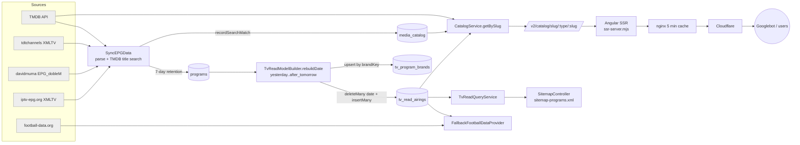
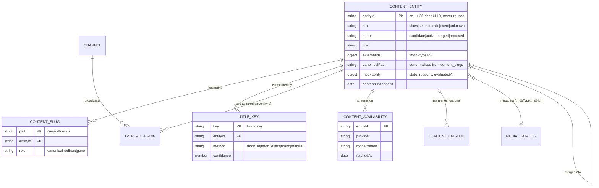
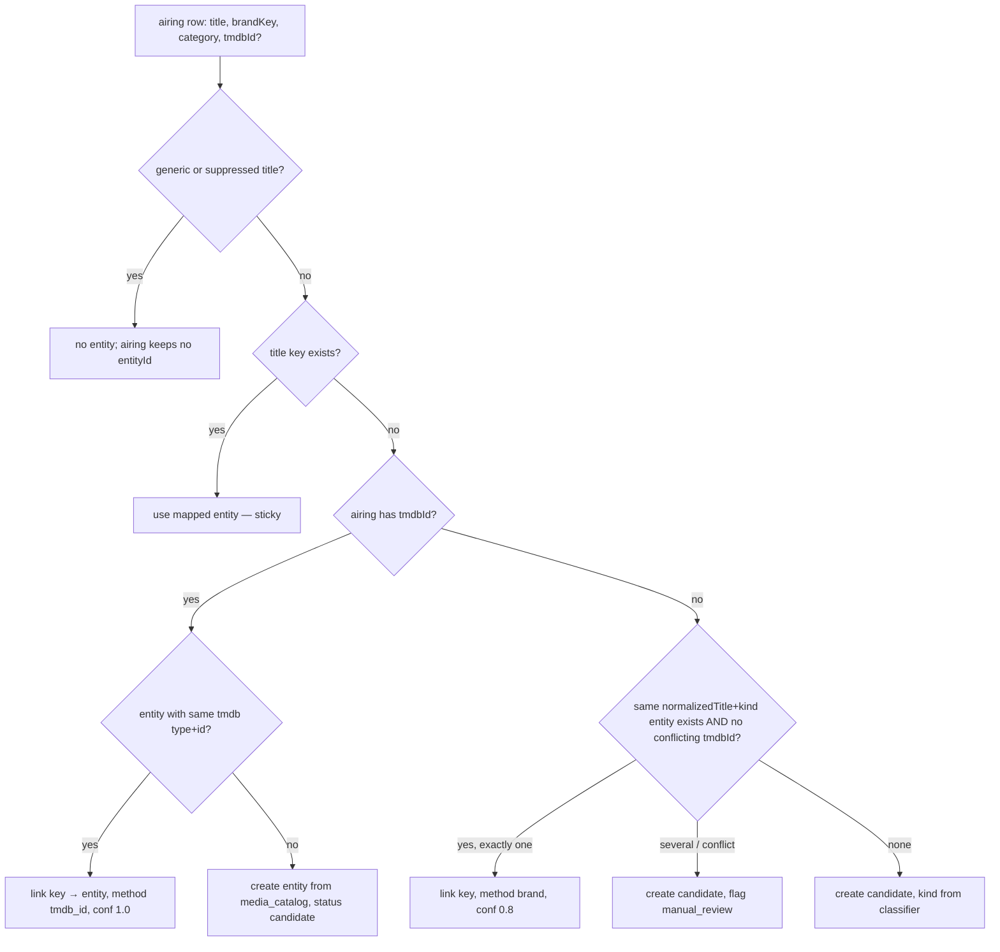
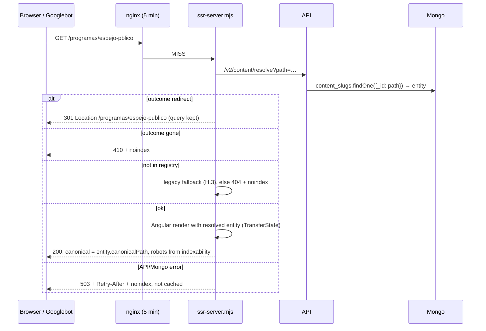

# GuíaTV — Phase 2C: persistent content entities and SEO migration (design, 2026-10-20)

**Design only.** No application code, database record, route, configuration or existing document was changed; nothing was deployed. This file is the only addition. Phase 2D must not start until this design is reviewed and approved (§P).

Evidence labels: **[V]** verified in this session (file:line, command or live URL); **[I]** inference from verified facts; **[Hyp]** hypothesis that needs the named check; **[P]** proposal (the design itself).

## 0. Baseline and method

- **Deployed baseline [V]:** production `/var/www/guiatv/current` → release `20261020175850`, `release.json` `gitSha` = `68ed98ab…` (the Phase 2B merge, PR #16). `origin/main` = `68ed98a`; its tree is identical to `72c36ef`, the last commit of `fix/ux-mobile-phase-2b`. All file:line references below are against that tree.
- **Read:** Phase 1 audit, Phase 2A and 2B reports, `SEO-MASTER-REPORT.md`, `redirect-map.csv`, issues #17–#22, the backend catalogue/EPG/football/sitemap code, the frontend catalogue routes and components, `ssr-server.mjs`, nginx config, existing tests.
- **Skills:** `mk-site-architecture`, `mk-programmatic-seo`, `seo-technical`, `seo-sitemap`, `seo-schema`, `seo-page` (project skills, read and applied). No dependency was installed and no paid API was used.
- **Data access, and its limit:** one read-only count query on the production database succeeded (collection sizes, §A.2). After that, the session's permission classifier blocked further database reads (production and local) as "production reads"; I did not work around it. Collision analysis therefore uses public data instead: the live sitemaps, the Search Console exports already on disk from Phase 1 (`.runtime/gsc/`, private, git-ignored; URLs only, no click or impression numbers are reproduced here), and a paced GET probe of every catalogue URL in them against production (§G). **The data-dependent numbers that need the database are listed in §P as approval items** (the read-only queries are written out in §N.4 so they can be run with approval).

### Issues #17–#22 and dependencies

| Issue | Relation to 2C/2D |
|---|---|
| #17 football legacy slugs / NOT_FOUND | Designed in §K. Shares one root cause with this design (SSR canonical override, §B.3), so the canonical fix lands once, in step 2D-0. |
| #18 contrast tokens | Independent. The new entity templates must use the fixed tokens; land #18 before 2D-5 or the new templates inherit the violations. |
| #19 LCP / `/tendencias` CLS | Independent; 2D-5 must not regress lab LCP on `/programas/*` (acceptance criterion). |
| #20 CORS 500 | Independent (backend middleware). Fix before 2D-10 so new 5xx alerts are meaningful. |
| #21 icon caching / missing icon | Independent; entity pages show channel icons, so it improves them. |
| #22 widget e2e flake | Independent (test only). |

---

## A. Current system architecture

### A.1 Data flow [V]



### A.2 Collections relevant to catalogue identity

Production sizes from the one permitted read-only query (2026-10-20) [V]:

| Collection | Docs | Model | What it is |
|---|---|---|---|
| `programs` | 202,151 | `Program.model.ts` | Raw parsed EPG rows. Id per airing. `tmdbId`, `normalizedTitle`, `titleAliases`, `brandKey`, `sourceFeed`, `sourceProgrammeId`. Deleted after 7 days (`CleanOldPrograms`, `daysToKeep: 7`, `syncScheduledFunction.ts:495`). |
| `tv_read_airings` | 756,049 | `TVReadAiring.model.ts` | Denormalised read model, one doc per airing per view date (`id` = `<date>_<channel>_<YYYYMMDDHHmmss>`, `tvMetadata.ts:1189`). Rebuilt per date with `deleteMany({date})` + `insertMany` (`TvReadModelBuilder.ts:402`). **No code path deletes past dates** (grep of every `deleteMany`), so history accumulates [V]; at the "20k+ airings per day" the code comments mention, that is ≈5 weeks [I]. |
| `tv_program_brands` | 149,829 | `TVProgramBrand.model.ts` | Upserted by `brandKey` on every rebuild (`TvReadModelBuilder.ts:406-415`), never deleted. The nearest thing to a persistent show identity today, but it is not used by any public read path except the media-catalogue backfill script [V]. Its size (≈150k keys) shows it contains episode titles, generic slots and noise [I]. |
| `media_catalog` | 17,153 | `MediaCatalogEntry.model.ts` | Persistent movie/series records. Unique sparse `(tmdbType, tmdbId)`; non-unique `normalizedIdentity`. Fed by EPG enrichment, search and detail views. **No slug, no programme kind, no availability, no airing link.** |
| `schedules` | 4 | `Schedule.model.ts` | Precomputed day layouts. Not identity. |
| `football_*` | 0 | `sports/models` | Empty in production; football is provider-backed, not stored. |

Not stored anywhere [V]: streaming availability (TMDB watch providers are cached in Redis/L1 for 24 h, `StreamingProvidersService.ts:35-41`), season/episode structure (the XMLTV parser reads `title`, `sub-title`, `desc`, `category`, `icon`, year, rating — not `episode-num`, `XMLParser.ts:98-110`), any slug registry, and any record of URLs already published.

### A.3 Identity, today [V]

| Concept | Current identity | Where |
|---|---|---|
| Airing | `tv_read_airings.id` (date + channel + local start time) | `tvMetadata.ts:1189` |
| Programme "brand" | `brandKey` = `normalizeTvToken(title)` minus `express`, `extra`, `temporada N`, `tN`, `edición N`, `eN`, `sNeN` | `tvMetadata.ts:337-346, 1091` |
| Movie / series | `tmdb:<movie|tv>:<id>` catalogue id; `media_catalog (tmdbType, tmdbId)` | `CatalogIdentity.ts`, `MediaCatalogEntry.model.ts:103` |
| Programme page | **the raw airing title**, slugified with the legacy slugifier, looked up in today's and tomorrow's airings | `CatalogService.ts:417-433, 1824-1864` |
| Series / film page | slug → local `media_catalog` title match → TMDB search → (if TMDB returned nothing) today's/tomorrow's airings → **else TMDB's first search result** | `CatalogService.ts:376-414` |
| Classification | substring tokens over `editorialCategory + genre + title`: contains `serie` → series; contains `cine`, `pelicula`, **`pel`** or `film` → movie; else programme | `CatalogService.ts:1648-1671` |
| Slug | `slugify` (drops non-ASCII letters: "Espejo Público" → `espejo-pblico`) for programmes; `slugifyTitle` (NFD transliteration) for TMDB titles | `CatalogService.ts:908-933`, `tvMetadata.ts:1239`, `utils/catalog.ts:96`, `utils/utils.ts:701` |
| Canonical (app) | `item.detailPath` = prefix by inferred type + slug of the title | `catalog-detail.component.ts:727` |
| Canonical (served) | **always `req.path`** — see §B.3 | `ssr-server.mjs:121-127, 491` |
| Robots | programme → index; movie/series → index only with ≥ 1 airing | `utils/catalog-indexability.ts` |
| Sitemap | distinct legacy slugs of today's + tomorrow's airings that have a `tmdbId` (193 URLs live today) | `SitemapController.ts:261-320`, `TvReadQueryService.ts:981` |

### A.4 Internal link producers [V]

Almost every card links to the API's `detailPath` (`epg-grid`, `unified-program-card`, `catalog-card`, search, home, chatbot) or rebuilds it from the title in `utils/tv-normalizers.ts:89,124`. Exceptions: `canal-completo.component.ts:466` links programmes to **`/contenido/program:<airingId>`** (ephemeral, see §B.5); `banner.component.ts:329-337` rebuilds `/programas|peliculas/<slugify(title)>`; `ChatbotRecommend.ts:2730` links matches to `/futbol/partido/…`, a path with no route.

---

## B. Root-cause analysis

### B.1 Why a programme page 404s after its airings expire [V]

1. `/programas/:slug` → `GET /v2/catalog/slug/program/:slug` → `CatalogService.getBySlug` (`CatalogService.ts:288`).
2. For `program`, `resolveBySlugInternal` calls `findTvReadItemBySlug(searchText, slug, today)` and then `…tomorrow` (`CatalogService.ts:417-433`). Each call reads `TVReadAiringModel.distinct('program.title', {date, searchTokens: token})` for **that one date** and compares `slugify(title) === slug` (`:1850-1862`).
3. If no airing on those two dates has a title whose legacy slug equals the URL, it throws `NotFoundError` → SSR 404 + `noindex`.

So the page's existence is a function of *the schedule for the next ~48 h*, not of whether we know the programme. The data is not even gone: `tv_read_airings` keeps past dates (§A.2) and `tv_program_brands` keeps every brand, but neither is consulted. A weekly show is a valid URL on air days and a 404 on the others; a series whose run ended is a 404 forever. This matches Phase 1's GSC finding that "not found" is dominated by `/programas/*`.

Secondary causes:
- `DateUtils.getTodayYYYYMMDD()` uses the server's local date (`dateUtils.ts:36`), and the read model's view dates come from the same helper, so they agree; but the window edges move at server midnight, not Madrid midnight [I] (the server's TZ was not checked).
- The programme negative cache is disabled on purpose (`CatalogService.ts:304-309`), so every miss re-runs up to 12 `distinct` queries; bots enumerating dead URLs pay that cost [V].

### B.2 Why one title has several indexable, self-canonical URLs [V]

- The slug is the **airing title**, not the show. "Friends T3" → `/programas/friends-t3`; "Friends" → `/programas/friends`. Season/episode markers are part of the title in the feeds (31 sitemap URLs carried `-tN`/`-eN` suffixes in Phase 1).
- The **prefix** depends on substring heuristics over category + title (§A.3). The same title can be `series` in one feed and `program` in another; `/series/x` additionally resolves through TMDB search, so it answers 200 for titles that `/programas/x` also answers. Live, 2026-10-20 [V]: `/series/friends` and `/programas/friends` both 200, `index`, self-canonical; `/programas/la-promesa` `index` while `/series/la-promesa` `noindex` (same programme, two pages).
- Classification false positives: the token `pel` matches any title or category containing "pel" (words such as "pelota", "pelea", "pelo", "papel") and turns it into a movie [I from code; affected titles not counted].
- **Wrong entity binding:** when the local catalogue has no match and TMDB's results contain no exact slug, the code returns `results[0]` (`CatalogService.ts:409-411`). Live [V]: `/peliculas/2` → 200 page for "捕风追影2" (an unrelated TMDB film whose title slugifies to `2`), canonical `/peliculas/2`. Any URL a bot invents can mint a page for an arbitrary film.

### B.3 Why the canonical never consolidates anything [V] — the shared root cause

`ssr-server.mjs:491`: `html = injectCanonical(stripStatusMarker(html), req.path);` and `injectCanonical` (`:121-127`) **replaces whatever canonical Angular rendered with `BASE_SITE_URL + req.path`**. Every server-rendered page is therefore self-canonical, whatever the component computed. Reproduced live on issue #17's URL:

| URL | API `match.slug` (cache-busted, MISS) | JSON-LD `url` in the SSR HTML | `<link rel=canonical>` in the SSR HTML |
|---|---|---|---|
| `/deportes/futbol/partido/ca-paranaense-se-palmeiras-2026-10-17` | `…-2026-10-18` | `…-2026-10-18` | **`…-2026-10-17`** |

The component sets the right canonical (`football-match-detail.component.ts:156`); the server overwrites it. After hydration the client-side `MetaService` writes the component's canonical back, so raw HTML and rendered DOM disagree — the conflict `seo-technical` warns about ("Google may use either one"). The same override makes `/programas/friends-t3`, accent-damaged slugs and every duplicate self-canonical even where `detailPath` already pointed elsewhere. The function exists for the CSR fallback shell (`:186`), where Angular rendered nothing; applying it to rendered pages is the bug.

**Consequence for this design:** canonical consolidation cannot work, for TV entities or football, until that line is fixed. It is step 2D-0.

### B.4 Why accented titles break [V]

`slugify` removes every character outside `[\w-]` without transliterating, so "Público" → `pblico`, "Código 10" → `cdigo-10`. `slugifyTitle` transliterates, and is used for TMDB titles only. The lookup compares the URL with `slugify(title)` (`CatalogService.ts:1855`), so the correctly spelled URL 404s (`/programas/espejo-publico` 404 live, `/programas/espejo-pblico` 200). Phase 1 R-02 still applies: changing the slugifier alone creates a third URL per title. Football has the same class of bug: `FootballNormalizer` turns "Bodø" into `bod` (Phase 1 TS-18).

### B.5 Legacy detail URLs return 503 instead of a redirect or 404 [V]

`/contenido/:catalogId`, `/detalles/:id` and `/program-full-details/:id` call `redirectLegacyCatalog` (`ssr-server.mjs:385-409`), which 301s only if `/v2/catalog/<id>` answers. For an expired airing, `TvReadQueryService.getItem` throws a plain `Error('TV read item not found')` (`TvReadQueryService.ts:1118`), not `NotFoundError`, so the API answers 500 and the SSR server answers **503 + `noindex, nofollow`** — permanently. Live: `/contenido/program:20260901_la_1_20260901150000` → 503. These are the URLs the channel page still emits today (§A.4), so the channel page keeps generating future 503s.

### B.6 Football NOT_FOUND under load [V] / [Hyp]

- Frontend: `FootballFacade.getMatch` maps **every** error to `null` (`football.facade.ts:58-63`, `catchError(() => of(null))`), and `null` renders "Partido no encontrado" (200, `noindex`). A 429 or 5xx is indistinguishable from a missing match [V].
- Backend: `FallbackFootballDataProvider.withNullableFallback` sends a throttled or failed primary call to the EPG provider (`FallbackFootballDataProvider.ts:69-76`), which has no data for provider-only competitions (Brasileirão, MLS…), so a rate limit becomes `NotFoundError` → 404 [V].
- API rate limiting: `generalRateLimit` is 100 requests/min per IP (`rateLimit.ts:35`) with no loopback exemption, and Angular's server-side `HttpClient` calls `http://127.0.0.1:4000` directly (`app.config.server.ts:11`) without forwarding the visitor's IP. **[Hyp]** every SSR render on the site therefore shares one rate-limit bucket, and a crawl burst returns 429 to SSR itself — consistent with #17's "429 for `clube-do-remo…` at that moment" and Phase 2A's transient 503s. Check: count `429` responses with `ip=127.0.0.1` in the API log during a crawl (log access needs approval, §P).

---

## C. Proposed domain model [P]

Separate *what a thing is* (entity) from *when it is on* (airing) and *where else it is* (availability). Football stays outside this model (§K).



| Concept | Responsibility | Lifetime |
|---|---|---|
| **Content entity** (`content_entities`, new) | Durable identity of a show, series, film or one-off event. Owns kind, title, metadata provenance, the canonical path and the indexability decision. | Forever. Never hard-deleted; `removed` or `merged` instead. |
| **Slug registry** (`content_slugs`, new) | Every public path ever assigned to an entity, with its role. The single answer to "what does this URL mean". | Forever; append-only except role changes. |
| **Title keys** (`content_title_keys`, new) | Sticky mapping from the ingestion key (`brandKey`) to an entity, with method and confidence. Makes resolution idempotent: the same feed title always lands on the same entity. | Forever; changed only by an explicit merge/split. |
| **Airing** (`tv_read_airings`, existing) | A dated broadcast. Gains `program.entityId` and `program.canonicalPath`, written at build time. | Retention policy (§L.3); rolled up into the entity before deletion. |
| **Episode/season** (`content_episodes`, new, **deferred**) | Only where reliable metadata exists (TMDB season/episode for a TMDB-linked series). No URLs of its own in 2D: sections and `#temporada-N` anchors on the series page. | Created in a later phase if the data supports it (§P). |
| **Availability** (`content_availability`, new) | Persisted TMDB watch-provider rows for ES, with source and freshness, replacing the Redis-only 24 h cache. | Rows expire logically by `fetchedAt`; replaced on refresh. |
| **External metadata** (`media_catalog`, existing) | TMDB metadata cache. Unchanged; entities reference it by `(tmdbType, tmdbId)`. | As today. |

Why not reuse `tv_program_brands` as the entity table: it has ≈150k keys with no kind, no merge/split history and no quality gate; it is the right *input* (title keys), not the identity [I]. Why not extend `media_catalog`: it only covers TMDB-known titles and is keyed by TMDB; shows without a TMDB entry ("Espejo Público", "La Promesa" in some feeds) need identity too, and TMDB ids must stay an attribute, not the key.

---

## D. MongoDB schema and indexes [P]

All writes are upserts keyed by unique indexes, so re-running any job is a no-op.

### D.1 `content_entities`

```js
{
  _id: ObjectId,
  entityId: "ce_01JBQ7Z4M8V2K5T3N9P6R1W0XY",   // unique, immutable, ULID
  kind: "series",                               // show | series | movie | event | unknown
  status: "active",                             // candidate | active | merged | removed
  mergedInto: null,                             // entityId when status = merged
  title: "Friends",
  normalizedTitle: "friends",
  originalTitle: "Friends",
  year: 1994,                                   // first release / first air year when known
  externalIds: { tmdb: { type: "tv", id: 1668 } },
  canonicalPath: "/series/friends",             // denormalised from content_slugs (role canonical)
  metadata: {
    synopsis: { value: "…", source: "tmdb", updatedAt: ISODate("2026-10-20") },
    genres:   { value: ["Comedia"], source: "tmdb" },
    images:   { poster: "…", backdrop: "…", source: "tmdb" }
  },
  airingStats: {                                // rolled up from tv_read_airings, survives retention
    firstAiredAt: ISODate("2026-08-03T14:00:00Z"),
    lastAiredAt:  ISODate("2026-10-20T15:10:00Z"),
    nextAiringAt: ISODate("2026-10-21T15:10:00Z"),
    channels: ["neox", "comedy-central"],
    airingCount90d: 212
  },
  indexability: { state: "index", reasons: ["upcoming_airings", "synopsis"], evaluatedAt: ISODate() },
  matching: { method: "tmdb_id", confidence: 1.0, decidedAt: ISODate(), decidedBy: "ingest" },
  contentChangedAt: ISODate("2026-10-19"),      // drives sitemap lastmod (§I.1)
  version: 7,                                   // bumped on every material change; part of cache keys
  createdAt: ISODate(), updatedAt: ISODate()
}
```

Indexes:
- `{ entityId: 1 }` unique.
- `{ "externalIds.tmdb.type": 1, "externalIds.tmdb.id": 1 }` unique, `partialFilterExpression: { "externalIds.tmdb.id": { $type: "number" }, status: { $in: ["candidate","active"] } }` — one live entity per TMDB title; merged/removed rows don't collide.
- `{ "indexability.state": 1, kind: 1, entityId: 1 }` — sitemap pagination.
- `{ normalizedTitle: 1, kind: 1 }` — collision checks and admin review (not unique, on purpose).
- `{ status: 1, "airingStats.lastAiredAt": 1 }` — retention and re-evaluation jobs.

### D.2 `content_slugs`

```js
{ _id: "/series/friends",        entityId: "ce_01JBQ…", role: "canonical", createdAt: ISODate(), reason: "initial" }
{ _id: "/programas/friends",     entityId: "ce_01JBQ…", role: "redirect",  createdAt: ISODate(), reason: "legacy_prefix" }
{ _id: "/programas/friends-t3",  entityId: "ce_01JBQ…", role: "redirect",  createdAt: ISODate(), reason: "legacy_season_suffix" }
{ _id: "/programas/espejo-pblico", entityId: "ce_01JBR…", role: "redirect", createdAt: ISODate(), reason: "legacy_accent_drop" }
{ _id: "/programas/especial-nochevieja-2025", entityId: "ce_01JBS…", role: "gone", createdAt: ISODate(), reason: "one_off_event" }
```

- `_id` = full path (prefix + slug): unique by construction, and a single `findOne({_id})` resolves any URL. Prefix is part of the key, so `/series/x` and `/programas/x` are distinct rows that can point at the same entity.
- `{ entityId: 1, role: 1 }` — find an entity's canonical path; partial unique `{ entityId: 1 }` where `role: "canonical"` — exactly one canonical per entity.
- A path is **never deleted and never re-pointed to a different entity** once it has served 200 (the reassignment exception is a manual, logged split, §E.5).

### D.3 `content_title_keys`

```js
{ _id: "friends", entityId: "ce_01JBQ…", method: "tmdb_id", confidence: 1.0,
  kindHint: "series", firstSeenAt: ISODate(), lastSeenAt: ISODate(), decidedBy: "ingest" }
```

- `_id` = `brandKey` (existing `buildProgramBrandKey`, unchanged so the backfill can reuse stored keys). One key → one entity. Two genuinely different titles that share a brand key (§E.3) are split by `kindHint`: the key becomes `friends|series` vs `friends|movie` only when a conflict is detected — not by default.
- `{ entityId: 1 }`.

### D.4 `tv_read_airings` (evolution, not a new collection)

- New fields written by `TvReadModelBuilder`: `program.entityId`, `program.canonicalPath`.
- New index `{ "program.entityId": 1, "airing.start": 1 }` (`idx_tvread_entity_start`) for "next airings of this entity" and the roll-up. The existing `idx_tvread_brand_date_start` stays until 2D-8 proves it unused.
- No existing field is removed or renamed; old rows without `entityId` stay readable.

### D.5 `content_availability`

```js
{ entityId: "ce_01JBQ…", country: "ES", providerId: 8, provider: "Netflix", monetization: "flatrate",
  source: "tmdb_watch_providers", attribution: "JustWatch", link: "https://www.themoviedb.org/tv/1668/watch?locale=ES",
  fetchedAt: ISODate("2026-10-20T06:00:00Z") }
```

Unique `{ entityId: 1, country: 1, providerId: 1, monetization: 1 }`. A refresh replaces the entity's row set in one `bulkWrite` and bumps `contentChangedAt` only if the set changed. Rows older than 30 days are not shown (§H.4).

### D.6 Storage estimate [I]

| Item | Estimate | Basis |
|---|---|---|
| Entities | 15k–40k docs × ~2 KB = 30–80 MB | upper bound = distinct brand keys seen with an airing in 90 days, after generic/suppressed filtering (needs the §N.4 query) |
| Slugs | 1.5–3 rows per entity × ~150 B ≈ 10 MB | |
| Title keys | ≤ 150k × ~150 B ≈ 25 MB | bounded by `tv_program_brands` |
| Availability | ~3 rows per TMDB-linked entity × 200 B ≈ 5 MB | |
| New airing index | ≈ 30–40 MB on 756k rows | ObjectId-sized keys |

Total ≈ 100–200 MB, against an existing `tv_read_airings` that is already the largest collection. No new service or paid tier is needed; the cost is disk and one extra index's RAM.

---

## E. Entity matching strategy [P]

### E.1 Pipeline (runs inside `TvReadModelBuilder.rebuildDate`, after airings are built, before insert)



- Batch, not per row: one `$in` query for the day's distinct brand keys (a few thousand), one for TMDB ids, then one `bulkWrite` per collection. Idempotent: unique `_id`s make a re-run a no-op [P].
- **Sticky mappings:** once `content_title_keys` maps a key, ingestion never re-points it. A better TMDB match later is recorded as a review suggestion, not applied, so URLs can't flip between entities.
- **Concurrency:** rebuilds for different dates may run in parallel. Entity creation uses insert-or-fetch on the unique `entityId`/TMDB index (retry on `E11000`), slug allocation inserts into `content_slugs` and retries with the next candidate on duplicate key. No locks.

### E.2 Stricter TMDB acceptance for *new* links

The current `titleMatches` (`SyncEPGData.ts:795-804`) accepts substring containment and Levenshtein ≤ 2 for short titles. That is acceptable for decorating an airing with a poster, but too loose to bind a permanent URL. For `content_title_keys` creation:

| Case | Auto-link | Otherwise |
|---|---|---|
| Normalised EPG title == normalised TMDB title or original title, and (film) EPG year within ±1 of release year or no EPG year, and TMDB type agrees with the classifier | yes, confidence 0.95 | — |
| Equality but type disagrees (EPG says series, TMDB result is a film) | no | candidate entity without TMDB link, `manual_review` |
| Containment / edit distance only | no | candidate without TMDB link; TMDB data may still decorate the airing as today |
| Several TMDB results with the equal title (remakes) | no, unless the year disambiguates to exactly one | `manual_review` |

### E.3 Same title, different works

Equal normalised titles are **never sufficient to merge** when either side has a TMDB id that differs from the other's. Examples the rules must keep apart: "Fargo" (1996 film vs 2014 series), "Cenicienta" (1950 / 2015 / 2021 films), "La novia" (several films), "Elvis" (2022 film vs documentaries), "Los invasores". Kind and TMDB id separate them; the slug policy (§F.4) gives them distinct URLs.

### E.4 Classification (replaces the substring heuristic)

Priority order, first rule that applies wins:
1. Manual override on the entity.
2. TMDB link: `movie` → `movie`; `tv` with TMDB `type` Scripted/Miniseries/Animation → `series`; other TMDB tv types (Talk Show, News, Reality, Documentary) → `show`.
3. EPG category vocabulary (exact category values per feed, mapped in a table, not `includes`): fiction series/telenovela → `series`; cine/película → `movie`; everything else → `show`.
4. Title pattern for one-off events (a year or date in the title, "especial", "gala", "final de…", "nochevieja", "campanadas") with ≤ 3 airings → `event`.
5. Otherwise `unknown` (never indexable, §J).

Sports matches (`program.sportFacet` set, football reconciled) are **not** entities; their airings keep linking to the football pages (§K).

### E.5 Merge and split

- Merge (two entities are the same work): `B.status = merged, B.mergedInto = A`; all `B` slugs become `redirect` → A's canonical; title keys re-pointed to A. Single-hop guarantee: redirects always store the *entity*, and the resolver returns the entity's *current* canonical, so a merge never creates a chain.
- Split (one entity is two works): manual, logged; the existing canonical path stays with the work that has the most airing history; the other gets a new path.

### E.6 Conflict resolution for metadata fields

Per field, highest-trust source wins: manual > TMDB (for synopsis, year, images, genres of TMDB-linked entities) > EPG primary feed > other EPG feeds. Each field stores its `source` and `updatedAt`. EPG descriptions often describe *one episode*; they are kept as airing descriptions and used as the entity synopsis only when no TMDB synopsis exists and the same text recurs across ≥ 2 airings (a show-level description, not an episode blurb) [P].

---

## F. Canonical URL policy [P]

### F.1 Prefixes

| Kind | Canonical prefix | Breadcrumb hub |
|---|---|---|
| `movie` | `/peliculas/:slug` | Películas → `/programacion-tv/peliculas` |
| `series` | `/series/:slug` | Series → `/programacion-tv/series` |
| `show`, `event`, `unknown` | `/programas/:slug` | Programas → `/programacion-tv/en-directo` (until a programme hub exists) |

The three existing prefixes are kept (they all hold historical URLs in Search Console). The *prefix is chosen by kind*, and the other two prefixes with the same slug 301 to it. Keeping series under `/programas/` (Phase 1 open question 2) is the alternative in §P.

### F.2 Slug function (`slugifyEntityTitle`, new, used for new allocations only)

1. Unicode NFKD, strip combining marks (á→a, ñ→n, ü→u, ç→c).
2. Explicit map for letters NFKD does not decompose: ø→o, æ→ae, œ→oe, ß→ss, ł→l, đ→d, þ→th.
3. Lower-case; `&` and `+` → `-`; apostrophes removed without a separator ("Grey's" → `greys`).
4. Any other non `[a-z0-9]` run → `-`; trim; collapse.
5. Max 80 characters, cut at a hyphen boundary.
6. Numbers kept as they are: `canta-2`, `24`, `1899`, `mananeros-360`.
7. Empty result (non-Latin script, e.g. "捕风追影2" → `2` or empty), or a result that is only digits, or a reserved word (§F.5) → use the Spanish TMDB title, then the original title, then **no slug and not indexable** (`unknown` entities get `/programas/ce-<last 8 of entityId>`, noindex).

The legacy `slugify` stays in the codebase only to *recognise* legacy URLs (§G) — never to allocate new ones.

### F.3 What is *not* in a slug

- Season or episode markers: `t3`, `temporada-3`, `e05`, `s01e05`, `capitulo-14`. The canonical is the show; seasons are `#temporada-3` sections.
- Edition qualifiers already stripped by `brandKey` (`express`, `extra`, `edicion-2`). These titles map to the parent show.
- Dates, channel names, EPG ids, TMDB ids (except the disambiguation in F.4 and the `unknown` fallback).

### F.4 Collisions

Deterministic, evaluated at allocation time against `content_slugs` (all roles, so a retired or redirect path is never reused for another work):
1. Free → take it.
2. Taken by the same entity → no-op.
3. Taken by another entity → append the year (`cenicienta-2015`); if still taken or no year, append the kind-neutral counter `-2`, `-3`.
4. **A registered path is never taken away** from its entity to give a "more famous" work the bare slug. The bare slug goes to whoever has it today — normally the one with legacy URL history. Changing that is a manual split (§E.5) with its own 301.

Reboots and remakes are different TMDB works → different entities → year-suffixed slugs. A revived show with the same TMDB id (new season after years) is the same entity.

### F.5 Reserved slugs

Generic titles are never entities and their legacy URLs are 410 (§G): `cine`, `pelicula`, `peliculas`, `serie`, `series`, `programa`, `programacion`, `noticias`, `informativos`, `deportes`, `teletienda`, `televenta`, `cierre`, `fin-de-emision`, `sin-titulo`, `por-determinar`. The list is seeded from `isGenericMovieTitle` and `ProgramDeduplicator.isGenericTitle`, which already exist [V].

### F.6 Unknown and changing kind

`unknown` entities live under `/programas/` with `noindex`. If an entity's kind is later corrected (e.g. `show` → `series`), the allocator writes the new canonical path and demotes the old one to `redirect`: one hop, because the resolver redirects to the entity's current canonical.

### F.7 Why a registry is required (not "regenerate the slug from the title")

- Titles change (TMDB localisation updates, EPG typo fixes, "HBO Max" style renames). Regeneration would silently move the URL; the registry keeps the old one as a 301.
- Collisions are order-dependent; only a stored decision makes them stable across rebuilds.
- Legacy URLs (accent-dropped, season-suffixed, wrong prefix) have to map to an entity; they cannot be derived from the current title.
- Lookup becomes one indexed `findOne` by path instead of up to 12 `distinct` scans over the day's airings (§B.1).

---

## G. Legacy migration inventory and mapping

### G.1 Sources and probe [V]

- **Sources:** live `sitemap*.xml` (194 catalogue URLs), and every guiaprogramaciontv.com URL in the Phase 1 Search Console exports under `.runtime/gsc/` (404 report, crawled-not-indexed, page tables, API pulls; as of 2026-10-12/17). Server logs: not available in this session (§P). Internal links: covered by the producers in §A.4 (they generate the same title-derived patterns).
- **Probe:** each of the **744** distinct `/programas|series|peliculas/*` URLs (plus one football URL) fetched once from production on 2026-10-20 ≈16:00–16:30 UTC, GET, manual redirects, 450 ms pacing, retries on 429/503 (none needed: 0 errors). Recorded: status, Location, raw-HTML canonical, robots, H1.
- **Per-URL mapping:** [`docs/seo/phase-2c/legacy-url-mapping.csv`](phase-2c/legacy-url-mapping.csv) (745 rows: path, status, robots, canonical-is-self, in sitemap, in GSC, proposed action, target, reason). URLs only; no Search Console metrics.

### G.2 What production does today with those URLs

| Prefix | 200 index | 200 noindex | 404 | Notes |
|---|---|---|---|---|
| `/programas/` | 226 | 0 | 292 | every 200 is self-canonical |
| `/peliculas/` | 0 | 118 | 59 | films without an airing are `noindex` by policy |
| `/series/` | 2 | 37 | 10 | |
| **Total** | **228** | **155** | **361** | 0 redirects, 0 5xx (plus 1 football URL, see §K) |

Two findings from the probe itself:
- **14 of the 194 URLs in today's `sitemap-programs.xml` already 404** (e.g. `/programas/bones-t1`, `/programas/chicago-med-t1`, `/programas/la-promesa-t1`, `/programas/sniper-grit`; API `NOT_FOUND` with a cache-busting query). The sitemap response is cached 6 h (`cache-control: max-age=21600`) and built from title slugs, so a read-model rebuild that changes or drops a title invalidates URLs the sitemap still lists [V for the 404s and the header; Hyp for the exact trigger]. Phase 2B's 305/305 crawl was earlier the same day: the set rotates within hours.
- Season/episode and accent damage are not edge cases: 60 probed URLs carry season/episode suffixes, 35 indexable programme URLs have accent-dropped slugs (e.g. `romera-del-roco` for "Romería del Rocío", `telenotcies-migdia`, `euskadi-qudate`, `joseba-arguiano-sukalerrian`).

### G.3 Mapping rules (applied by `register-legacy-paths`, 2D-3)

Each legacy path gets one registry row; the action is decided by the first matching rule:

| # | Pattern | Action | Target | Count in probe |
|---|---|---|---|---|
| 1 | Reserved/generic or digit-only slug (`/programas/noticias`, `/peliculas/2`, `/peliculas/29`) | **410 GONE** | — | 3 |
| 2 | Season/episode suffix (`-tN`, `-tN-eN`, `-eN`, `-temporada-N`, `-capitulo-N…`, `-sNeN`) | **301 REDIRECT** | the show entity matched through its title key (brandKey), at its canonical path | 60 (21 currently 200, 39 404) |
| 3 | 200 today, slug ≠ transliterated slug of the title (accent drop) | **301 REDIRECT** | entity canonical, e.g. `/programas/espejo-pblico` → `/programas/espejo-publico` | 35 |
| 4 | Same slug answering 200 under two prefixes (`/series/la-promesa` + `/programas/la-promesa`, `/series/modern-family` + `/programas/modern-family`) | **KEEP** the prefix the entity's kind selects, **301** the other | e.g. `/programas/modern-family` → `/series/modern-family` | 4 (2 pairs) |
| 5 | 200 + index, slug already equals the entity slug | **KEEP** (becomes the registry's canonical row) | — | 168 |
| 6 | 200 + noindex film/series (TMDB metadata, no airing) | **NOINDEX** (200) until §J's facts exist | — | 152 |
| 7 | 404 programme with a title key in airing history | **RESTORE AS PERSISTENT ENTITY** (200, indexability per §J) | its own path if it equals the entity slug, else 301 to it | up to 254 |
| 7b | …the matched entity is an `event` (one-off: fights, single matches, galas — e.g. `ffc-36-finley-thomas-vs-wade-mills`, `primera-federacin-t2526-zamora-unionistas`) | **410 GONE** | — | subset of the 254 |
| 8 | 404 film/series with a `media_catalog` or entity match | **RESTORE** (usually 200 noindex, §J) or 301 to the canonical spelling | e.g. `/peliculas/asesinato-en-mnaco` → `/peliculas/asesinato-en-monaco` | up to 68 |
| 9 | 404 and no entity match after backfill | **404** stays (not 410: we can't assert it existed) | — | remainder of 7/8 |
| 10 | Ambiguous: several entities match (remakes, same brand key with different TMDB ids) | **MANUAL REVIEW** | — | determined by the §N.4 collision query |
| — | Existing legacy patterns (`/contenido/:catalogId`, `/detalles/:id`, `/program-full-details/:id`, `/pelicula-details/:id`) | **301** to the entity canonical when the id resolves (airing id → title key → entity; TMDB id → entity); **410** when the airing id is past retention and has no entity; never 503 for a resolvable "missing" (fixes §B.5) | | |
| — | `/ver-canal/*`, `/programacion-tv/ver-canal/*`, everything in `redirect-map.csv` | **KEEP** (unchanged, already single-hop 301s) | | |

The counts for rules 7–10 can only be split after the backfill dry run (they depend on the history query, §P item 1). The dry-run report lists every legacy URL with its rule and target for review before any redirect goes live.

### G.4 Example old → new mappings

| Old URL (status today) | New | Rule |
|---|---|---|
| `/programas/espejo-pblico` (200) | 301 → `/programas/espejo-publico` | 3 |
| `/programas/espejo-publico` (404) | 200, canonical | entity canonical |
| `/programas/friends-t3` (200) | 301 → `/series/friends` | 2 + kind |
| `/programas/friends` (200) | 301 → `/series/friends` | 4 |
| `/series/friends` (200) | 200, canonical | 5 |
| `/programas/la-promesa-t1` (404, in sitemap) | 301 → `/series/la-promesa` | 2 |
| `/programas/la-promesa` (200 index) / `/series/la-promesa` (200 noindex) | `/series/la-promesa` canonical, the other 301 (or the reverse if §P item 2 keeps series under `/programas/`) | 4 |
| `/programas/sueos-de-libertad-t1-e672` (404, in sitemap) | 301 → `/series/suenos-de-libertad` | 2 + 3 |
| `/programas/romera-del-roco` (200) | 301 → `/programas/romeria-del-rocio` (or 410 if classified `event`) | 3 / 7b |
| `/programas/noticias-24-h-e518` (404) | 301 → `/programas/noticias-24-h` | 2 |
| `/peliculas/a-great-awakening` (200 noindex, H1 "El gran despertar") | stays (registered first); `/peliculas/el-gran-despertar` registered as 301 → it | 5 + F.4 |
| `/peliculas/autopista-hacia-el-cielo-t1` (404) | 301 → `/series/autopista-hacia-el-cielo` | 2 + kind |
| `/peliculas/2` (200, unrelated Chinese film) | 410 | 1 |
| `/programas/noticias` (200) | 410 | 1 |
| `/contenido/program:20260901_la_1_20260901150000` (503) | 301 → the entity of that airing, else 410 | legacy pattern |

### G.5 Redirect hygiene

- **No home-page redirects:** an unmatched URL is 404/410, never `/`.
- **Single hop by construction:** a redirect row stores an *entity*, and the resolver answers that entity's current canonical; a merged entity resolves through `mergedInto` before answering (the resolver follows at most one merge link and the merge job rewrites older links, so chains can't build up). The probe asserts ≤ 1 hop and no cycle.
- **Query strings:** kept on 301 (as the Phase 2A/2B redirects do), except tracking-only parameters, which the canonical already ignores.
- **Fragments:** never added to `Location`. A season URL redirects to the show; the season is a section on that page.

---

## H. SSR and caching design [P]

### H.1 Resolution contract (new endpoint)

`GET /v2/content/resolve?path=/programas/espejo-pblico` — reads only Mongo (`content_slugs` → `content_entities`), never TMDB or a feed, so a provider timeout cannot turn into a 404.

```jsonc
// 200 — canonical hit
{ "success": true, "data": { "outcome": "ok", "canonicalPath": "/programas/espejo-publico",
  "entity": { "entityId": "ce_01JBR…", "kind": "show", "title": "Espejo Público", "version": 12,
              "indexability": { "state": "index", "reasons": ["upcoming_airings","synopsis"] } } } }
// 200 — the path is a redirect (merge, legacy prefix, legacy slug)
{ "success": true, "data": { "outcome": "redirect", "location": "/programas/espejo-publico" } }
// 200 — retired
{ "success": true, "data": { "outcome": "gone" } }
// 404 — the path is not in the registry
{ "success": false, "error": { "code": "NOT_FOUND" } }
// 503 — Mongo unavailable (never 404)
```

`GET /v2/content/:entityId` returns the page payload (entity + next 14 days of airings from `tv_read_airings` via `idx_tvread_entity_start` + availability + recent airing history), and `GET /v2/content/:entityId/enrichment` keeps today's deferred-enrichment pattern (related, social, user state).

### H.2 SSR request flow



- Redirects and 410 are decided in `ssr-server.mjs` (as `redirectLegacyCatalog` already does), because Angular's own redirects are 302s [V: Phase 2A moved `/deportes` to the server for this reason].
- **Canonical comes from the entity**, never from `req.path`. 2D-0 changes `injectCanonical` to apply only when the rendered HTML has no canonical (the CSR fallback shell).
- The page renders 200 only when it has content; empty data is 503 (outage) or a reasoned `noindex` (§J), never an empty indexable 200 — the Phase 2A/2B resilience guarantees (`seo:ssr-resilience`) stay as acceptance tests.

### H.3 Legacy fallback while the registry is incomplete

During rollout (2D-6 behind a flag), a registry miss for `/programas|series|peliculas/:slug` tries, in order: the legacy resolver (today's code) → if it finds an airing, attach its title key's entity and 301 to the entity's canonical if different. This keeps every URL that works today working while the backfill catches up, and records the path in `content_slugs` (role `redirect`) so the next hit is a direct lookup. After 2D-7 acceptance the fallback is removed and registry misses are plain 404.

### H.4 Caching

| Layer | Key | TTL | Invalidation |
|---|---|---|---|
| API L1/Redis, resolve | `content:resolve:<path>` | 10 min | delete on slug write for that path |
| API L1/Redis, page payload | `content:page:<entityId>:v<version>:<madridDate>` | 10 min | version bump on material change; Madrid date in the key rolls the airing list over at local midnight |
| API negative cache | `content:resolve:miss:<path>` | 30 min | delete when a slug for the path is inserted (registry misses are authoritative, unlike today's per-day programme lookup) |
| Single-flight | in-process `Map<path, Promise>` | request | — (existing `inFlightSlugLookups` pattern, `CatalogService.ts:99`) |
| SSR in-memory | path | existing | unchanged |
| nginx | `$request_uri` | 200: 5 min (existing); 301/410: 1 h (new); 404: 5 min (new); 5xx: never | time-based; a deploy purge script exists for releases |
| Cloudflare | — | DYNAMIC today [V] | unchanged |

Availability older than 30 days is hidden rather than shown as current; between 7 and 30 days it shows with its "actualizado" date. TMDB outages therefore degrade the page (fewer facts) without changing its status. If the degradation removes the only useful facts, the indexability rule (§J) — evaluated by the job, not per request — decides; a request never flips an entity to 404.

### H.5 Query efficiency

- Resolve: one `_id` lookup + one `entityId` lookup (both unique indexes).
- Page: entity + `tv_read_airings.find({ "program.entityId": id, "airing.end": { $gt: now }, "airing.start": { $lt: now + 14d } }).sort({ "airing.start": 1 }).limit(50)` on `idx_tvread_entity_start` + availability by `entityId`. Three indexed queries instead of today's up-to-12 `distinct` calls per miss.
- Sitemap: range scans on `{ indexability.state, kind, entityId }`, 10k per page.

### H.6 SSR → API rate limiting (fix together with 2D-0)

Exempt loopback SSR traffic from `generalRateLimit` (or have the SSR server forward the visitor IP in a header the API trusts only from 127.0.0.1), so a crawl burst cannot rate-limit the renderer itself (§B.6). Per-visitor limits stay.

---

## I. Sitemap and internal linking design [P]

### I.1 Sitemaps

- **Source:** `content_entities` with `status: active` and `indexability.state: "index"` only. Never airings. One row per entity → one URL → no duplicates by construction; noindex entities are excluded by the same field that sets the robots tag, so the two can't disagree.
- **Files:** keep `sitemap-programs.xml` (existing URL in the index and in Search Console) for kind `show`; add `sitemap-series.xml` and `sitemap-peliculas.xml`. If a file passes 10,000 URLs, it becomes `sitemap-programs-1.xml`… listed in the index (limit is 50,000/50 MB; 10k keeps responses small).
- **`lastmod` = `contentChangedAt`**, which changes only when the page's substance changes: title, synopsis, images, kind/canonical, availability set, or the airing *state* (gains its first upcoming airing in the 14-day window, or loses the last one). Day-to-day rotation of a daily show's times does not bump it, so the sitemap stops churning with the schedule. Never in the future; omitted if unknown (the Phase 2A rules stay).
- No `changefreq`/`priority` (ignored by Google; `seo-sitemap`).
- Incremental: entities write `contentChangedAt`; the sitemap response is cached 1 h and rebuilt from the index scan. Search Console submission keeps the existing every-6-h job.
- Expectation: inclusion helps discovery; it does not guarantee indexing.

### I.2 Internal linking

- One producer: the backend writes `program.canonicalPath` on every airing row (D.4) and `canonicalPath` on every catalogue DTO. Cards use it as is; the frontend stops rebuilding paths from titles (`tv-normalizers.ts:89,124`, `banner.component.ts:329-337`).
- Channel schedules (`canal-completo.component.ts:466`) link to `canonicalPath` instead of `/contenido/program:<airingId>`.
- Search suggestions return entities (one result per entity, not per airing).
- Related content links entities; an entity never links to itself under another prefix.
- Guides: add an "entity link" helper for editorial posts so `/guias/*` can link to `/series/x` by entity id (the post stores the id; the link follows the current canonical).
- Breadcrumbs: Inicio › Series|Películas|Programas › Title, from the entity kind (`catalog-detail.component.ts:787-799` already has this shape). `generateTVSeriesSchema` must take the canonical URL as a parameter (it hard-codes `/series/`, noted at `catalog-detail.component.ts:764-771`).
- Chatbot football links: `/futbol/partido/…` → `/deportes/futbol/partido/…` (`ChatbotRecommend.ts:2730`).
- Migration of existing links: because nearly every link comes from the API's `detailPath`, switching the backend to `canonicalPath` migrates them in one release; the three frontend producers above are the only code changes. The crawl (`seo:crawl`) asserts that no internal link answers 301.

### I.3 Structured data

- `Movie` for films, `TVSeries` for series and shows (schema.org has no better type for a non-fiction programme; `TVSeries` is correct for any episodic TV programme). Each with `url` = canonical, `name`, `image`, `description`, `datePublished`/`startDate` when known, and `potentialAction`-free.
- Upcoming airings: `publication` → `BroadcastEvent` (`startDate`, `endDate`, `publishedOn` → `BroadcastService` with channel name) only for airings in the next 14 days; no future-dated fabricated events.
- `BreadcrumbList` from the visible breadcrumb only (Phase 2A rule).
- No `FAQPage`, `HowTo` or aggregate ratings from TMDB (third-party ratings don't qualify for review snippets).

---

## J. SEO indexability rules [P]

Evaluated by a job (on ingest for touched entities, and nightly for all), stored on the entity, read by the page and the sitemap.

### J.1 Useful facts

A page is useful when it answers at least one real question about the title for a visitor in Spain:

| Fact group | Counts when |
|---|---|
| **Upcoming airings** | ≥ 1 airing in the next 14 days on a channel with an indexable channel page |
| **Streaming availability** | ≥ 1 ES provider row fetched ≤ 7 days ago |
| **Description** | an entity-level synopsis (TMDB, or a recurring show-level EPG description, §E.6) that says more than the title, channel and genre |
| **Airing history** | ≥ 1 airing in the last 90 days, with channel and day/time pattern ("de lunes a viernes a las 12:20 en Antena 3") |
| **Identity facts** | year + genre, or cast/director (TMDB) |

No word counts: the rule counts facts, not length.

### J.2 Status matrix

| Situation | HTTP | Robots | Sitemap |
|---|---|---|---|
| Entity `active`, kind known, **(upcoming airings or streaming) and one more group** | 200 | index | yes |
| Entity `active`, description + airing history, no current airings or streaming (e.g. a seasonal show off-air) | 200 | index | yes |
| Entity `active`, only one fact group (e.g. a film title with TMDB metadata but no airing and no ES availability — "provider metadata alone") | 200 | noindex, follow | no |
| Entity `candidate` (not yet reviewed / below confidence) or kind `unknown` | 200 | noindex, follow | no |
| Path is a `redirect` in the registry (legacy slug, other prefix, merged entity) | 301 → current canonical | — | no |
| Entity `removed` (one-off event > 30 days after its last airing, or withdrawn) | 410 | noindex | no |
| Reserved generic slug (§F.5) | 410 | noindex | no |
| Path never registered and the legacy fallback finds nothing | 404 | noindex | no |
| Mongo/API failure | 503 + Retry-After, not cached | noindex | — |
| TMDB/feed failure | page status from the stored decision; missing sections hidden | stored decision | stored decision |

Hysteresis: an indexed entity is demoted to `noindex` only after 30 consecutive days without enough facts, so a weekly show doesn't flap between index and noindex.

### J.3 Templates

| Template | When | Main content | Primary CTA |
|---|---|---|---|
| Programme with current airings | `show`/`event`, upcoming airings | "Cuándo echan X": next airings by day with channel links, today's live slot, show description, airing pattern | channel page / reminder |
| Programme without current airings | `show`, airing history but nothing in 14 days | "X no está programado ahora mismo", last seen on (channel, date), usual slot, description, streaming if any, related shows on the same channel | streaming or related |
| Series | `series` | synopsis, seasons (TMDB), where to stream in Spain (with source + date), upcoming TV airings, cast | stream / next airing |
| Movie | `movie` | synopsis, year, runtime, director/cast, ES streaming, upcoming TV airings ("la echan el sábado a las 22:00 en La 1") | stream / airing |
| Partial metadata | any kind with few facts | only the facts that exist; no empty blocks, no placeholder text; `noindex` per J.2 | channel / search |
| Unknown / removed | 404 / 410 | short message, search box, links to today's guide; no fake content | search |

### J.4 Volume control

The first indexed set is limited to entities that already have a legacy URL with history (Search Console or sitemap, §G) plus entities with upcoming airings and a description. Expanding beyond that (e.g. TMDB films with ES availability and no airing) is an explicit later decision (§P), measured against index coverage — not automatic.

---

## K. Football issue #17 repair design [P]

Kept out of the TV entity model: matches are provider-owned, dated events with their own lifecycle.

### K.1 Verified causes

1. **Self-canonical legacy slug:** the SSR canonical override (§B.3). The API already returns the right `match.slug`.
2. **Both slugs indexable:** consequence of 1 plus no redirect (Phase 2A limitation 3).
3. **NOT_FOUND under throttling:** the facade maps any error to not-found (§B.6), and the backend fallback turns a throttled primary into an EPG miss → `NotFoundError`.
4. **429:** football-data.org throttling (handled by the adapter's circuit, `FootballDataOrgAdapter.ts:240-273`) and, [Hyp], our own loopback rate limit (§B.6).
5. **Detail cache keyed by the requested slug** (`v2:football:match:<slug>`, `FootballQueryService.ts:168-169`), 60 s fresh / 15 min stale: each spelling of a match is cached and fetched separately, and a miss for a non-today slug costs a dated provider call (Phase 2A limitation 6).

### K.2 Repair

| Concern | Design |
|---|---|
| Canonical source | `match.slug` from the provider match (Madrid kickoff date), never the request path. Fixed by 2D-0's `injectCanonical` change; no football-specific code. |
| Redirect policy | `ssr-server.mjs` pre-resolves `/deportes/futbol/partido/:slug`: if the API's `match.slug` ≠ requested slug → **301** to `/deportes/futbol/partido/<match.slug>` (query kept). One hop: the API returns the current slug, so a twice-renamed match still lands in one step. |
| Provider errors | New `ProviderUnavailableError` (503) distinct from not-found. `FallbackFootballDataProvider.getMatch`: primary throws → serve the last good cached detail for that match id (stale allowed up to 24 h) → else 503. The EPG fallback is used for `getMatch` only when the slug resolves in EPG data (EPG-sourced matches); it is not a "not found" oracle for provider competitions. |
| Frontend | `FootballFacade.getMatch` keeps `null` only for HTTP 404; other errors become an `unavailable` state that calls `MetaService.markUnavailable` (503 + noindex, not cached), exactly as `catalog-detail` already does. |
| Cache | Two keys: `v2:football:match:id:<providerId>` (detail, existing SWR policy) and `v2:football:slug:<slug>` → provider id (7 days, written for both the current and the legacy slug). A legacy slug becomes a cheap id lookup + 301. Negative cache only on a real provider 404, 10 min. Invalidation: the existing admin `/football/refresh` clears both prefixes. |
| Rate limiting | Loopback exemption (§H.6). |
| Lifecycle (needs a decision, §P) | Finished matches: 200 + `index` for 7 days after kickoff (result + where it was shown), then `noindex, follow`; no sitemap inclusion until the policy is approved. |

### K.3 Acceptance

- `/deportes/futbol/partido/ca-paranaense-se-palmeiras-2026-10-17` → 301 → `…-2026-10-18`; the target's raw HTML canonical = its own path and equals the JSON-LD `url`.
- With the provider forced to throw (unit test with a throwing primary), a cached match renders 200; an uncached one renders 503 + noindex, never "Partido no encontrado".
- 200 parallel SSR renders from one client do not produce a single 429 from the API to the SSR process.
- Crawl: no match URL is both 200-indexable and non-canonical.

---

## L. Performance and reliability considerations

### L.1 Load [I]

| Area | Effect |
|---|---|
| Mongo reads (pages) | Lower than today for misses (3 indexed lookups vs up to 12 `distinct`), similar for hits. |
| Mongo writes (ingest) | Per rebuilt day: one `$in` read on title keys, one bulk upsert of new keys/entities (hundreds/day after backfill), `program.entityId` written inside the existing `insertMany` (no extra pass). |
| Ingest duration | + a few seconds per date (batched); measure in 2D-2 and fail the acceptance if > +20 %. |
| Backend memory | Batches of ≤ 5,000 keys; no full-collection loads. The backfill streams `tv_read_airings` by date with a cursor. |
| SSR latency | + one API call (resolve) on catalogue routes, cached; − TMDB search on misses. Target: p95 TTFB on `/programas/*` not worse than today (`perf:critical`). |
| Cache hit rate | Better: one key per entity instead of per spelling/day; negative cache becomes valid for 30 min instead of disabled. |
| Storage | ≈ 100–200 MB (§D.6). |

### L.2 Safety principles

- **Additive first:** new collections and fields; nothing existing is dropped or renamed until the new path has run in production for a full cycle.
- **Dual read behind flags:** `CONTENT_ENTITIES_READ` (resolver), `CONTENT_ENTITIES_REDIRECTS` (301s), `CONTENT_ENTITIES_SITEMAP`. Each flag can be turned off without a deploy (env + restart).
- **EPG data is never deleted to make room:** `tv_read_airings` retention (L.3) starts only after the roll-up into `airingStats` is verified for every entity with history.
- **Backups:** `mongodump` of `tv_read_airings`, `tv_program_brands`, `media_catalog` before the backfill; the backfill writes only the new collections and the new airing fields.

### L.3 Airing retention (needs a decision, §P)

Today past airings accumulate without limit (§A.2). Proposal: keep 120 days of `tv_read_airings`, deleting older dates with a batched job (not a TTL index, so it can be paused) **only after** `airingStats` for the affected entities is current. That bounds the largest collection; entities keep their history summary forever.

### L.4 Search-side risks

- A large set of 301s at once is normal for a migration; Search Console will report "Page with redirect". Redirect targets must be 200 + index + self-canonical, or Google ignores the hint.
- Turning hundreds of 404s back into 200 pages is the goal, but only pages passing §J are indexable, to avoid replacing "not found" with "crawled – not indexed" thin pages.
- No bulk indexing requests; the sitemap is the signal.

### L.5 Rollback

Every step in §M has its own rollback. The general one: flags off → the legacy resolver serves exactly today's behaviour; new collections are inert. 301s already seen by Google are not undone (the targets keep working either way, because a redirect row always points at a live entity).

### L.6 Infrastructure cost

No new service, no new paid API. Costs: ~100–200 MB disk, one extra index in RAM, a few extra seconds per ingest. TMDB usage stays within today's pattern, but see the licensing item in §P: TMDB's API terms distinguish commercial use and require JustWatch attribution for watch-provider data.

---

## M. Implementation phases (Phase 2D)

Each step is a separate PR, deployable and revertible alone. Order matters where a dependency is listed.

| # | Change | Files | Data migration | Depends on | Risk | Automated tests | Acceptance | Rollback |
|---|---|---|---|---|---|---|---|---|
| **2D-0** | SSR canonical stops overriding rendered pages; loopback exemption for SSR→API rate limit | `apps/frontend/scripts/ssr-server.mjs` (`injectCanonical` only when the HTML has none), `apps/backend/src/presentation/middlewares/rateLimit.ts` | none | — | Pages whose component sets a wrong canonical now expose it → run the crawl first and fix any found | resilience script: rendered page keeps component canonical; CSR shell gets `req.path`; rate-limit unit test for loopback | crawl: every 200 page's raw-HTML canonical == JS canonical; #17 legacy URL canonical → `-10-18` | revert one commit |
| **2D-1** | Schemas and indexes (`content_entities`, `content_slugs`, `content_title_keys`, `content_availability`, airing index) | `infrastructure/database/models/*.model.ts` (4 new), `initializeMongoCollections.ts`, `scripts/create-indexes.ts` | index build on `tv_read_airings` (background) | — | index build I/O on the largest collection | model unit tests (unique/partial indexes via Mongoose schema introspection) | indexes exist in prod; no query plan regression on existing indexes | drop new collections/index |
| **2D-2** | Ingestion-time entity resolution (§E), writes `program.entityId`/`canonicalPath`; slug allocator (§F) | `application/services/TvReadModelBuilder.ts`, new `application/services/ContentEntityResolver.ts`, new `shared/utils/entitySlug.ts` | none (new rows only) | 2D-1 | over-/under-merging; ingest time | resolver tests with the §N.2 fixtures; slug snapshot test (all §F.2 cases); idempotency test (two runs, same output) | two consecutive rebuilds produce identical mappings; ingest time ≤ +20 %; manual review of the 200 most-aired entities shows 0 wrong merges | flag off (`CONTENT_ENTITIES_WRITE`); airing fields are ignored by readers |
| **2D-3** | Backfill and dedup: entities from `tv_program_brands` + `tv_read_airings` history + `media_catalog`; legacy URL registration (§G) | new `scripts/backfill-content-entities.ts`, `scripts/register-legacy-paths.ts` | yes: reads all history, writes new collections only; dry-run report first | 2D-2 | bad mapping at scale | dry-run diff report; tests on fixtures; assertion: every §G "RESTORE"/"301" URL has a registry row | dry-run report reviewed by the owner; collision list (§N.4) reviewed; 0 registry rows pointing at `merged` entities | delete new collections' rows by `createdBy: backfill` |
| **2D-4** | Persistent catalogue API: `/v2/content/resolve`, `/v2/content/:entityId`, enrichment; availability persistence | `presentation/routes/content.routes.ts`, `controllers/ContentController.ts`, `application/services/ContentEntityService.ts`, `StreamingProvidersService.ts` (persist rows) | availability refresh job (TMDB, paced) | 2D-1..3 | API load | controller tests (ok/redirect/gone/404/503 contract), cache key tests, single-flight test | p95 resolve < 20 ms on the server; contract tests pass | routes unused by the frontend until 2D-5 |
| **2D-5** | Angular SSR integration: catalogue detail renders from the entity payload; templates §J.3 | `pages/catalog-detail/*`, `services/catalog.service.ts`, `utils/catalog-indexability.ts` (reads stored decision), schema generators | none | 2D-4, #18 | template regressions, LCP | Karma specs per template state; responsive Playwright (2B suite) incl. new states | 2B responsive suite green; Lighthouse lab LCP on a programme page not worse than main (5 runs, same setup) | flag `CONTENT_ENTITIES_READ` off → legacy component path |
| **2D-6** | Canonical generation from entity identity; legacy fallback (H.3) | `ssr-server.mjs` (pre-resolve), `catalog-detail.component.ts` | registry rows created lazily by fallback | 2D-0, 2D-5 | wrong canonical at scale | resilience probes: canonical == entity canonical for each §G sample | crawl: 0 indexable pages whose canonical ≠ own path | flag off |
| **2D-7** | Legacy 301/410 at HTTP level from the registry; football 301 (§K) | `ssr-server.mjs`, `FootballQueryService.ts`, `FallbackFootballDataProvider.ts`, `football.facade.ts` | none | 2D-3, 2D-6 | redirect loops/chains | probe every §G URL: single hop, final 200 + index + self-canonical, or 410/404 as mapped; loop detector in the probe | 100 % of §G rows behave as mapped | flag `CONTENT_ENTITIES_REDIRECTS` off |
| **2D-8** | Sitemap migration (§I.1) | `SitemapController.ts`, `TvReadQueryService.getIndexableProgramSitemapRows` (removed after) | none | 2D-7 | dropping URLs Google relies on | `SitemapController.test.ts`: only `index` entities, no redirects/noindex, lastmod rules | `seo:crawl` on the new sitemaps: 100 % 200 + index + self-canonical | flag `CONTENT_ENTITIES_SITEMAP` off → old builder |
| **2D-9** | Internal link migration (§I.2) | `canal-completo.component.ts`, `banner.component.ts`, `tv-normalizers.ts`, `ChatbotRecommend.ts`, search | none | 2D-6 | missed producers | crawl: no internal link returns 301/404; unit tests for each producer | 0 internal 301/404 links on a full crawl | revert |
| **2D-10** | Production validation and monitoring | `scripts/seo-crawl.mjs` (registry probe set), dashboard query docs | none | all | — | crawl + resilience + responsive suites on production | §N.3 checks pass on the deployed release; GSC "Not found (404)" for catalogue paths trending down after 4–6 weeks | — |

2D-0 and the football part of 2D-7 can ship first, independently of the entity work, because they only depend on existing data.

---

## N. Test strategy

### N.1 Levels

- **Unit (node:test, existing runner):** slug function snapshot (§F.2 cases: accents, ñ, ø, apostrophes, `&`, numbers, non-Latin, 80-char cut, reserved words); classifier table; matching decision table (§E.2/E.3); indexability matrix (§J.2, including hysteresis); redirect resolution (merge chains collapse to one hop); football error mapping (429/5xx → unavailable, 404 → not found).
- **Integration (existing fakes pattern, no new framework):** resolver with in-memory repositories: ingest the same fixture twice → identical entities, slugs, keys (idempotency); concurrent allocation of the same slug → one winner, one `-2`.
- **Frontend (Karma):** each template state renders the right sections, robots and canonical; no empty sections.
- **E2E/HTTP (existing scripts):** `seo:ssr-resilience` gains: registry redirect 301 single hop, 410 for `gone`, 503 (not 404) when the API is down, canonical == entity canonical; `seo:crawl` gains a probe list built from §G; Playwright responsive suite covers the new templates at the 2B widths.

### N.2 Fixtures (from real titles seen in this audit)

`Friends` / `Friends T3`; `Espejo Público` (accent); `Mañaneros 360` / `Mañaneros 360 T3`; `Código 10`; `Equipo de investigación`; `La Promesa` (series vs programme classification); `Cenicienta` ×3 years; `Fargo` film vs series; `Elvis`; `捕风追影2` (non-Latin); `Canta 2`, `24`; `Aquí no hay quien viva - Capítulo 14` (episode in title); `Cine` (generic); `Especial Nochevieja 2025` (event).

### N.3 Production checks after each deploy

1. `npm run seo:crawl` → 0 issues; sitemap URLs 100 % 200 + index + self-canonical.
2. §G probe list → each URL matches its mapped action, ≤ 1 hop.
3. `npm run seo:ssr-resilience` → all OK.
4. `E2E_BASE_URL=https://guiaprogramaciontv.com npx playwright test e2e/specs/responsive.spec.ts`.
5. Raw-HTML canonical equals rendered canonical on a sample of 50 pages.

### N.4 Read-only queries to run once approved (inputs for 2D-3 and §P)

```js
// distinct brand keys with ≥1 airing in 90 days, excluding generic/suppressed
db.tv_read_airings.aggregate([
  { $match: { date: { $gte: "20260722" }, "trustDecision.consumerSuppressed": { $ne: true },
              "program.titleResolutionState": { $nin: ["generic_unresolved","generic_suppressed"] } } },
  { $group: { _id: "$program.brandKey", titles: { $addToSet: "$program.title" }, n: { $sum: 1 },
              tmdb: { $addToSet: "$program.tmdbId" }, cats: { $addToSet: "$program.editorialCategory" } } },
  { $project: { n: 1, titles: { $slice: ["$titles", 5] }, tmdb: 1, cats: 1, tmdbCount: { $size: "$tmdb" } } }
], { allowDiskUse: true })
// collisions: same brand key, >1 distinct TMDB id → manual review list
// same legacy slug, >1 brand key → slug collision list
// oldest/newest date in tv_read_airings and docs per date → retention sizing
// media_catalog: same normalizedTitle, >1 tmdbId → remake list
```

---

## O. Risk register

| ID | Risk | Likelihood | Impact | Mitigation |
|---|---|---|---|---|
| R-01 | Wrong merges bind unrelated titles to one URL | medium | high | strict auto-link rules (§E.2), TMDB id conflict blocks merge, manual review list, sticky keys, split procedure |
| R-02 | Under-merging leaves duplicates (two entities for one show) | medium | medium | brand key + TMDB id; dedup report in 2D-3; merge creates one-hop 301s |
| R-03 | Slug function change creates a third URL per title | high if done alone | high | registry: legacy spellings registered as redirects before new slugs go live; snapshot test |
| R-04 | Redirect chains or loops | low | high | redirects resolve to the entity's *current* canonical (one hop by construction); probe with loop detection |
| R-05 | Mass reindexing of thin pages | medium | high | §J rules, hysteresis, first index set limited (§J.4) |
| R-06 | Canonical fix (2D-0) exposes wrong component canonicals | medium | medium | crawl diff of raw vs rendered canonical before enabling |
| R-07 | Backfill load on production Mongo | low | medium | cursor by date, batches, off-peak, dry run first |
| R-08 | Index build on `tv_read_airings` affects live queries | low | medium | background build, off-peak, after a `mongodump` |
| R-09 | TMDB licensing/attribution (commercial use, JustWatch attribution for providers) | unknown | high | owner/legal decision before availability persistence ships (§P) |
| R-10 | Provider outage renders pages without facts | medium | low | stored decision, stale-with-date, hide >30-day availability |
| R-11 | Frontend and backend version skew during deploy | low | medium | single release already ships both (`deploy-guiatv.sh`); flags default off |
| R-12 | Rate-limit exemption abused by spoofed loopback traffic | low | medium | exemption by socket address 127.0.0.1 only, never by header |
| R-13 | Football 301 sends users to a match that later changes date | low | low | slug map refreshed with the match; target always resolves via provider id |
| R-14 | Retention job deletes history still needed | low | high | runs only after roll-up verification; paused by flag; backups |

---

## P. Open decisions requiring approval

1. **Database read access for the data-dependent numbers.** Approve running the §N.4 read-only queries (production, or a fresh dump) so entity counts, collision lists and retention sizing replace the estimates in §D.6 and §G. Without them, 2D-3 can't be accepted.
2. **Series prefix.** Recommended: kind-based prefixes (`/series/` for scripted series, `/programas/` for other shows, `/peliculas/` for films). Alternative: every TV title under `/programas/` (fewer redirects for series that today rank under `/programas/`, but loses the series/film intent split). Decide before 2D-2.
3. **Season/episode pages.** Recommended: none in 2D (sections + anchors). Revisit only with TMDB season data and demand evidence.
4. **First indexable set (§J.4).** Recommended: legacy-URL entities + entities with upcoming airings and a description. Approve before 2D-8; widening it is a later, measured decision.
5. **Airing retention (§L.3).** Recommended: 120 days of `tv_read_airings` after roll-up. Or keep unlimited and accept growth.
6. **One-off events.** Recommended: kind `event`, indexable while upcoming, 410 thirty days after the last airing.
7. **Football finished matches (§K.2).** Recommended: index for 7 days after kickoff, then `noindex, follow`; no sitemap until decided.
8. **TMDB/JustWatch terms.** The site carries AdSense; TMDB's API terms treat commercial use separately and require attribution for watch-provider data (sourced from JustWatch). Owner to confirm the licensing position before 2D-4 persists availability. This is not legal advice.
9. **Log access** for the §B.6 rate-limit hypothesis (API access log, 429s from 127.0.0.1 during a crawl). Optional: 2D-0 fixes it either way.
10. **Manual review ownership:** who reviews the `manual_review` queue (collisions, remakes) and how often.

**STOP.** Phase 2C ends here. Phase 2D starts only after these decisions are taken and this design is approved.
